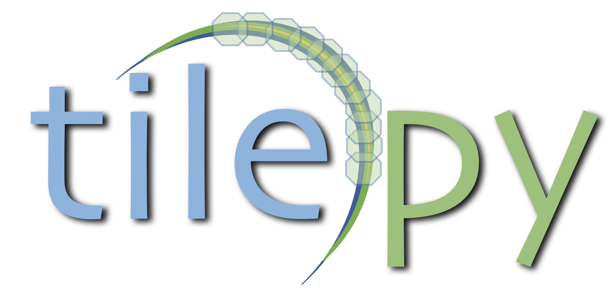

<p align="center">
  <a href="" rel="noopener">
    
  </a>
</p>

<div align="center">


[](https://doi.org/10.5281/zenodo.12190543)
[](https://pypi.org/project/tilepy/)
[](https://github.com/astro-transients/tilepy/blob/master/LICENSE.rst)
[](https://cla-assistant.io/astro-transients/tilepy)
[](https://doi.org/10.3847/1538-4365/ad5bde)
[](https://tilepy.readthedocs.io/en/latest)

### Documentation: [tilepy.readthedocs.io](https://tilepy.readthedocs.io/)


</div>

## Installation

We clone the repo, create an environment to work, activate the environment and install the package. You can use conda or mamba for this.

```python
git clone git@github.com:astro-transients/tilepy.git
cd tilepy
conda env create -n tilepyenv -f environment.yml
conda activate tilepyenv
python -m pip install .
```
Some users have encounter problems with the use of the `mocpy` package within conda. If this is your case follow these instructions:
```python
- remove mocpy from the environment.yml
- create and activate the environment as described above
- run "pip install mocpy"
```

If you prefer to avoid conda and use a virtual environment with your favorite python version, use the following sequence:
```
python -m venv tilepy_venv
source tilepy_venv/bin/activate
pip install --upgrade pip
pip install .
```

Requirements of the installation:

- The current version of the package **only** runs with `python>=3.11`. It is tested with Python 3.11 and 3.12. The required versions of the dependencies are given in `pyproject.toml` (and in `environment.yml` for conda).
- Note that by creating the env from the environment.yml, the libraries and versions needed will be installed automatically.
- Note that every time we made changes to the package, you should reinstall the package by running ```pip install .``` in the project root directory. The changes will be only applied to the env in which you are working.
- The package relies on 'curl' to download the localisation map of the multi-messenger events.

In the case you are working in CC-Lyon, the easiest solution is to do```ccenv conda ``` and then follow the instructions given above.

If you have any problem with the installation of the package, please drop an email to `astro.tilepy@gmail.com` or join the discussion forum at `https://forum.astro-colibri.science/c/instrumentation-and-tools/tilepy`

## Creation of a galaxy catalog

For using the 3D algorithm tilepy need to have access to a galaxy catalog. Currently, the only supported catalog is GLADE+. You'll find the download link on this webpage : https://glade.elte.hu.
To prepare it for usage by tilepy we provide a the `ConvertGalaxyCatalog.py` script that converts the original catalog into a hdf5 file compatible with tilepy. The script is located in the `tilepy/tools` repository.

Example: use the script to keep only galaxies that are within 500 Mpc (recommended). It reads the downloaded `GLADE+.txt` file and creates the output file `Gladeplus.h5` which is the one that should be used with tilepy. You'll be able to specify the path to that file in your tilepy configuration. The examples assume the `Gladeplus.h5` to be located in the `tilepy/dataset/` directory.

```bash
python ConvertGalaxyCatalog.py --input GLADE+.txt --output Gladeplus.h5 --max-luminosity-distance 500
```

## Description

Package including functions to perform GW follow-up scheduling and simulations in IACTS. The package can be found in the folder tilepy, which contains the following folders:

- src/tilepy: Folder including the python package
    - tilepy.include: The main files were functions are placed. In the usual case, the manager script is ObservationScheduler.py. At the following level, we have TilingDetermination.py. And the base set of functions are in CampaignDefinition.py, Observatories.py, PointingPlotting.py, PointingTools.py and RankingObservationTimes.py.
    - tilepy.tools: Includes several scripts that have been used so far for different aims related to visualization and catalog cleaning
    - tilepy.scripts: Further support scripts

- github/workflows: a series of workflows are enabled and triggered via GitHub Actions.
- docs: sources of the documentation, published at [tilepy.readthedocs.io](https://tilepy.readthedocs.io/)

- examples: Examples on how to use tilepy, see dedicated <a href="examples/README.md">README</a>
    - [quickstart_tilepy.ipynb](examples/quickstart_tilepy.ipynb): **start here.** A guided, end-to-end tour, from a localization map to a schedule, on a real event. Every cell is already executed, so it can be read without running anything. The documentation renders this very file, as [Quick start](https://tilepy.readthedocs.io/en/latest/tutorials/quickstart_tilepy.html).
    - launcher: Jupyter notebooks and .py scripts to run observation schedules for various use-cases. We recommend to use the Jupyter notebooks as these are more comprehensive, specially with the inputs given.
    - paperplots: Precise plots of ApJS Series, Volume 274 Number 1 (11pp), 2024 September
    - sciencecases: Support material and extra plots connected to those of the paper ApJS Series, Volume 274 Number 1 (11pp), 2024 September
    - visualization: Several notebooks to improve the visualization of observation campaigns
    - config: various examples of configuration files, used in the notebooks to run the scripts. The format is the following:
       - [observatory]
          - name: name of the observatory (it is not critical, you can use any name)
          - lat: lat coordinates of the observatory
          - lon: lon coordinates of the observatory
          - height: height of the observatory
          - base: `ground` or `space`. With `space`, the orbit of the satellite, the Earth occultation and the South Atlantic Anomaly are taken into account
          - stationsurl: (space) URL of a TLE file with the orbit of the satellite, e.g. https://celestrak.com/NORAD/elements/science.txt; `name` must be the name of the satellite in that file
          - wobbleOffset: wobble offset in deg (not used yet)

        - [visibility]
          - sunDown: altitude of the Sun in deg to define darkness conditions (for astronomic darkness sunDown= -18)
          - moonDown: altitude of the Moon in deg to define darkness conditions (for astronomic darkness moonDown= -0.5)
          - moonGrey: altitude of the Moon in deg to define greyness conditions
          - moonPhase: phase of the Moon to define greyness conditions
          - minMoonSourceSeparation: minimum separation Source-Moon in deg to define greyness conditions
          - maxMoonSourceSeparation: max separation Source-Moon in deg to define greyness conditions
          - EarthDown: (space) margin in deg added around the Earth disc occulting the sky
          - SAAThreshold: (space) magnetic field strength in nT below which the satellite is considered to be in the South Atlantic Anomaly and does not observe (computed with the IGRF coefficients of the dataset directory; 0 disables the check)

        - [operations]
          - maxZenith: max zenith angle which will be considered as accessible sky
          - FOV: radius of the circular FoV defining the tiles
          - maxRuns: maximum number of tiles that will be scheduled
          - maxNights: total number of nights considered
          - duration: standard exposure per tile
          - minDuration: minimal duration of tile if standard exposure is not available (e.g. at the end of the night)
          - useGreytime: flag to schedule greyness observations in addition to darkness
          - minSlewing: (not used yet)
          - shape: (not used yet, the shape of the FoV is given by numberSides)
          - numberSides: 0 for a circular FoV of radius FOV, n >= 3 for a regular polygon on the sky with n sides and its vertices at FOV from the centre, the first one due east (space scheduling and GetBestTiles2D/3D only; the integrated strategy always uses the circle)
          - FoVRotation: rotation of a polygonal FoV (not used yet)

        - [tiling]

          - minimumProbCutforCatalogue: only galaxies that have probabilities higher than 'minimumProbCutforCatalogue x (GW x galaxy)_max' participate in the scheduling calculation
          - minProbcut:  minimal probability covered per tile to schedule observation
          - distCut: distance cut to define the mandatory use of 2D strategy (coming from galaxy catalogue completeness)
          - doPlot: produce detailed plots of the scheduling
          - secondRound: consider two maps for scheduling
          - zenithWeighting: weight on probability that would be applied to prioritize coordinates that have lower zenith angle values. Step size is 5 deg in zenith (0.75 is a reasonable value)
          - percentageMOC: percentage of the sky localization region that will be considered to compute the MOC
          - reducedNside: nside of the low-resolution skymap used as a grid to speed up the computation
          - HRnside: nside of the high-resolution skymap used to compute the covered probability
          - mangrove: flag to use the mangrove method of weighting by the mass of the host galaxy
          - countPrevious: True if you want previous observation to be considered in number to set the max run variable. False else
          - countSubtractedPointingsOutside: False if you do not want to take into account pointings outside of the current percentageMOC area when subtracting pointings, True if you want to subtract them anyway
          - locCut: maximal area in deg² of the percentageMOC region; no schedule is computed for larger regions (default 99999)
          - algorithm: `2D` to always use the 2D strategy, `3D` to use the galaxy catalogue when possible (distance information in the map, event closer than distCut, not close to the Galactic plane)
          - strategy: (3D) `integrated` to use the probability of all the galaxies in the FoV, `targeted` to use the probability of each galaxy
          - doRank: rank the pointings and produce the ranking files and the altitude vs time plot
          - alphaR, betaR: (space) weights used to order the pointings: the next one minimizes alphaR × distance − betaR × probability (both normalized)

        - [general]
          - downloadMaxRetry: number of new attempts if the download of the sky map fails
          - downloadWaitPeriodRetry: time in seconds between two download attempts
          - eventName: (optional) name of the event

## Running tilepy offline or behind a firewall

tilepy needs two reference files that are normally obtained automatically. No manual step is required on a machine with internet access.

- **Planetary ephemeris (`de440s.bsp`)**, used to compute the dark-time windows. It is downloaded once from JPL into `~/.skyfield/`. Without access to the JPL server, either copy the file to `~/.skyfield/`, set the environment variable `TILEPY_EPHEMERIS` to the path of an ephemeris file, or install the bundled ephemeris with `pip install "tilepy[offline]"`.
- **Earth orientation parameters (`finals2000A`)**, used by Astropy for coordinate transformations. Astropy tries to download a recent version and otherwise uses the table shipped with the `astropy-iers-data` package, so nothing has to be configured. On a machine that stays offline, update that package from time to time (`pip install -U astropy-iers-data`), and add the following lines before importing tilepy to skip the download attempts:

```python
from astropy.utils import iers

iers.conf.auto_download = False
```

See the [installation guide](https://tilepy.readthedocs.io/) for details.

## Help
If you find any problem, please open a new issue in the project main page to document it. You can of course also directly create a Pull Request with new features.

Otherwise you can also contact us at `astro.tilepy@gmail.com`
A user/developer discussion forum is available at `https://forum.astro-colibri.science/c/instrumentation-and-tools/tilepy`
